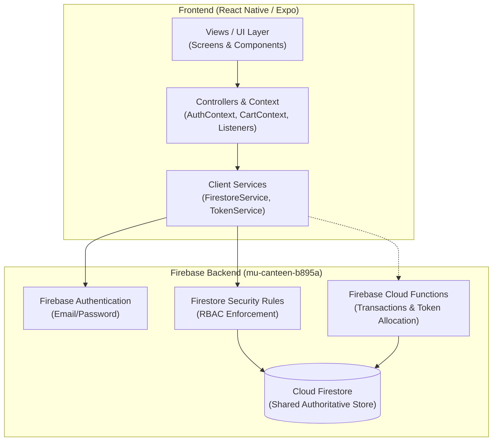
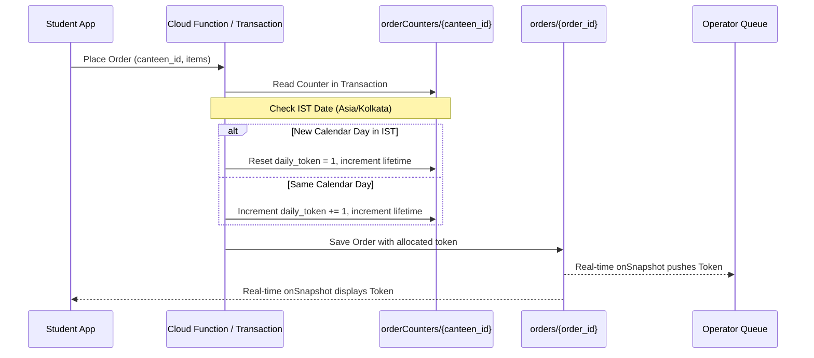

# System Architecture Documentation

**Project:** MU Canteen  
**Institution:** Marwadi University, Rajkot  
**Pattern:** Model-View-Controller (MVC) + Reactive Cloud Backend

---

## 1. Architectural Overview

MU Canteen is structured following a mobile-first, client-server architecture powered by React Native (Expo) on the client side and Google Cloud Firebase (Cloud Firestore, Firebase Authentication, Cloud Functions) on the backend.



---

## 2. Model-View-Controller (MVC) Structure

### 2.1 Models (`src/models/types.ts`)
- Authoritative TypeScript data interfaces representing entities:
  - `UserProfile`, `RoleDefinition`
  - `Building`, `Canteen`
  - `MenuCategory`, `MenuItem`
  - `Order`, `OrderItemSnapshot`, `OrderCounter`
  - `AuditLog`, `PaymentHistory`, `DailyRevenue`

### 2.2 Views (`src/screens/` & `src/components/`)
- Pure presentation layer:
  - Student views: `StudentHomeScreen`, `CanteenDirectoryScreen`, `CanteenMenuScreen`, `CartScreen`, `PreorderPolicyScreen`, `OrderTrackingScreen`, `OrderHistoryScreen`, `ProfileScreen`.
  - Operator views: `OperatorDashboardScreen`, `OperatorQueueScreen`, `MenuManagementScreen`, `PickupVerificationScreen`, `OperatorReportsScreen`.
  - Admin views: `AdminDashboardScreen`, `UserManagementScreen`, `CanteenManagementScreen`, `AdminOrdersScreen`, `AuditLogsScreen`.
  - Reusable components: `Header`, `FoodCard`, `CanteenCard`, `FoodImagePlaceholder`, `FloatingCategoryModal`, `FilterChips`, `StatusBadge`, `OrderCardCompact`, `DashboardNavCard`.

### 2.3 Controllers (`src/context/` & `src/services/`)
- `AuthContext`: Coordinates session lifecycle, Firebase Auth state, user profile hydration, and demo role switching.
- `CartContext`: Enforces single-canteen cart isolation, handles quantity changes, order mode (Instant vs Preorder), and policy agreement state.
- `FirestoreService`: Handles real-time query listeners (`onSnapshot`) for multi-device sync, transactional counter updates, menu availability toggling, and canteen status management.

---

## 3. Multi-Device Real-Time Synchronization Solution

A primary defect identified in earlier prototypes was that when two students placed orders on different physical devices for the same canteen, the operator's device either failed to display both orders or showed only locally cached data.

### Root Cause Analysis:
1. **Per-Device Local Storage Leaks**: Previous implementations fell back to unauthoritative `AsyncStorage` when Firestore latency occurred.
2. **Incorrect Query Scopes**: Operator queries erroneously filtered by `user_id == currentOperatorId` instead of `canteen_id == assignedCanteenId`.
3. **Security Rule Disconnects**: Strict rules previously blocked operators from reading order documents created by students.

### Resolution Implemented:
1. **Cloud Firestore Authoritative Truth**: All orders are written to `/orders/{orderId}`. Local storage is strictly reserved for non-authoritative theme preferences and auth tokens.
2. **Targeted Real-time Listeners**:
   - Operator Queue:
     ```typescript
     query(collection(db, 'orders'), where('canteen_id', '==', assignedCanteenId), orderBy('created_at', 'desc'))
     ```
     This triggers instantaneously on the operator's phone whenever *any* student on campus places an order.
   - Student History (Private):
     ```typescript
     query(collection(db, 'orders'), where('user_id', '==', studentUserId), orderBy('created_at', 'desc'))
     ```
     Guarantees student privacy so Student A cannot inspect Student B's orders.
3. **Reactive Bidirectional Status Updates**:
   When the operator clicks `Accept (Start Prep)`, `Ready for Pickup`, or `Verify & Mark Collected`, Firestore propagates the state update directly to the student's `OrderTrackingScreen` via `onSnapshot` without manual refreshing.

---

## 4. Concurrency-Safe Daily Numeric Token Allocation

Unlike alphanumeric hash codes (e.g. `ord_89274`), canteen operations require concise, human-readable numbers (`1`, `2`, `3`) that kitchen staff can call out at the pickup counter.



- **Timezone Anchor**: `Asia/Kolkata` (IST, UTC+5:30).
- **Daily Reset**: When calendar date changes in IST, token counter begins at 1 for each individual canteen.
- **Lifetime Preservation**: Separate `lifetime_order_count` field never resets and provides campus historical reporting.

