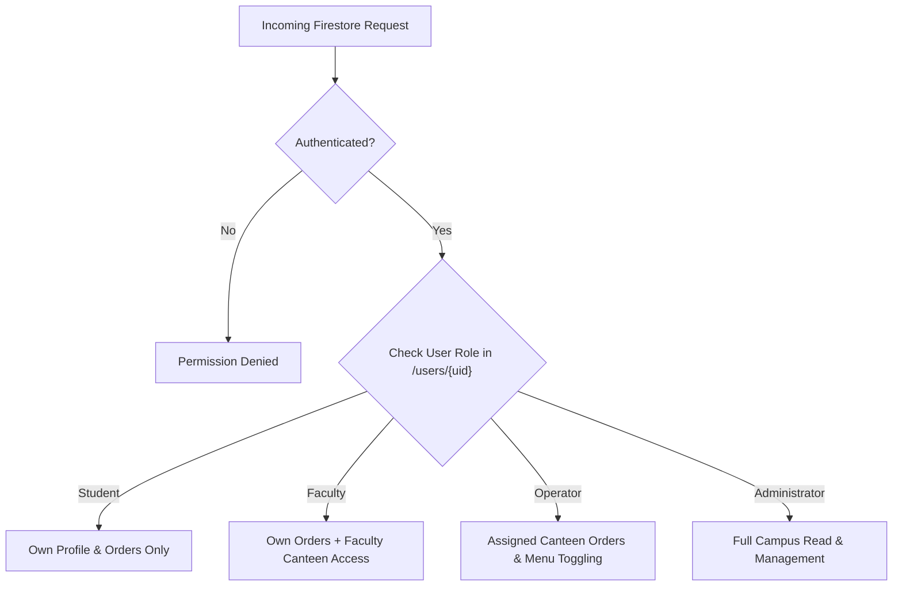

# Firestore Security Rules & Access Control

**File:** `backend/firestore.rules`  
**Security Standard:** Principle of Least Privilege (PoLP) + Role-Based Access Control (RBAC)

---

## 1. Security Architecture Summary

All read and write access to Cloud Firestore documents is gated by user authentication state (`request.auth != null`) and verified against the user's authoritative document in `/users/{userId}`.

---

## 2. Granular Rules Definition

### 2.1 User Isolation (`/users/{userId}`)
- Any authenticated user can read public user records (needed to display customer and operator names).
- Users can create their own initial profile during registration.
- Non-admin users cannot mutate their own `role_id` or `assigned_canteen_ids` (preventing privilege escalation).
- Deletion is strictly reserved for Administrators.

### 2.2 Shared Orders Queue (`/orders/{orderId}`)
- **Student Access**: Only the owner (`resource.data.user_id == request.auth.uid`) can read their order documents.
- **Operator Access**: Allowed only if the order's `canteen_id` is contained within the operator's `assigned_canteen_ids`.
- **Admin Access**: Unrestricted campus-wide read access.
- **State Machine Enforcement**:
  - Students can only transition orders from `awaiting_acceptance` to `cancelled`. Once preparation starts, cancellations are blocked.
  - Operators can update orders for their assigned canteens to valid subsequent states (`preparing`, `ready_for_pickup`, `picked_up`, `declined`).

### 2.3 Immutable Audit Logs (`/auditLogs/{logId}`)
- **Append-Only**: Authenticated clients and backend Cloud Functions can write audit logs.
- **Tamper-Proof**: Updates and deletions are strictly disabled (`allow update, delete: if false;`).
- **Read Access**: Restricted exclusively to College Administrators.

### 2.4 Menu Items Management (`/menuItems/{itemId}`)
- Active menu items are publicly readable by campus users.
- Canteen operators can update `is_available` and `price` only for items belonging to their assigned canteen.
- New item creation or deletion requires Administrator privilege.

