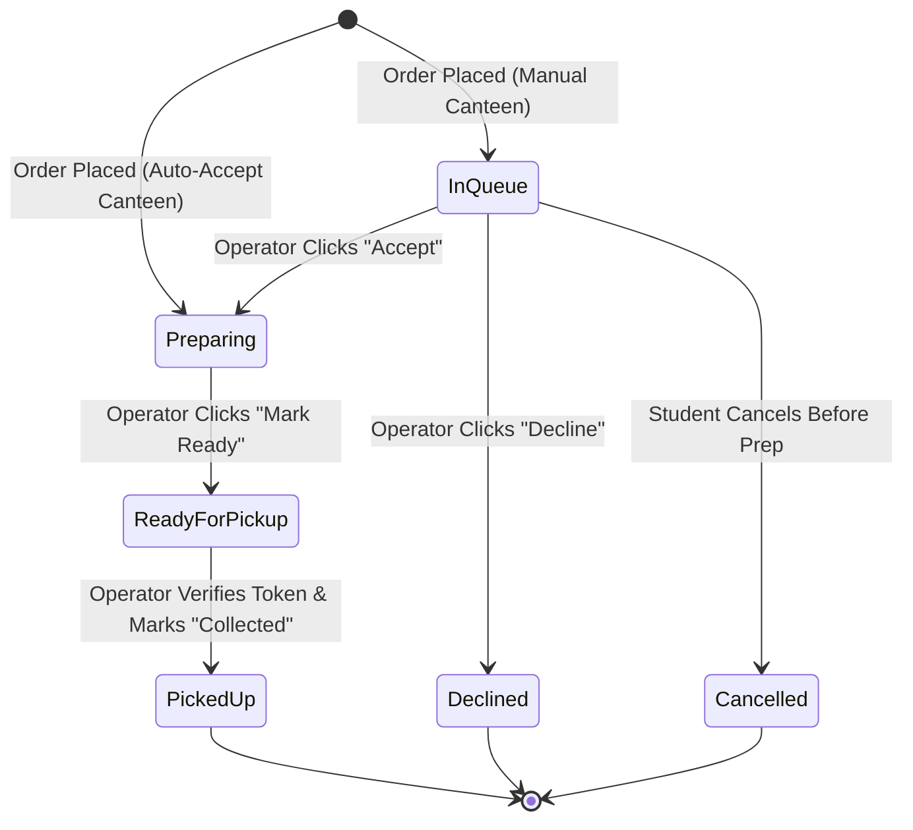

# Complete Order Lifecycle & Operator Workflow

**Project:** MU Canteen  
**Scope:** Review 1 Implementation

---

## 1. High-Level State Machine

---

## 2. Step-by-Step Workflows

### 2.1 Instant Order Workflow
1. **Browse & Discovery**: Student searches dishes or filters by Pure Veg, category, or building.
2. **Select Canteen & Add to Cart**: Items are added to cart. If student attempts to add an item from a different canteen, the app warns that an order must belong to one canteen only.
3. **Cart Review**: Student reviews quantities, subtotal, and selects "Instant Order".
4. **Checkout & Daily Token Generation**:
   - Order is validated against active canteen status and item availability.
   - An atomic Firestore transaction calculates the daily token (e.g. `#1`, `#2`) based on the canteen counter for today's date in `Asia/Kolkata`.
5. **Real-time Queue Arrival**: The order appears immediately in the canteen operator's horizontal card queue.
6. **Student Tracking**: Student transitions to the live `OrderTrackingScreen` showing their Token # and active timeline step.

---

### 2.2 Scheduled Preorder Workflow
1. **Select Canteen & Food**: Student adds lunch/recess items to cart.
2. **Select Break Slot**: Student selects an available break time (e.g. `12:45 PM (Lunch Break)`).
3. **Mandatory Policy Screen**:
   - Cart automatically navigates to `PreorderPolicyScreen`.
   - Displays 10-minute pickup grace period, cancellation terms, and uncollected order policy.
   - Requires explicit checkbox agreement: *"I have read, understood, and explicitly agree to the Marwadi University Preorder Policy."*
   - Checkout button remains disabled until checked.
4. **Order Confirmation**: Order is placed with `order_type: "preorder"` and scheduled pickup slot stored.
5. **Queue Display**: Operator sees `PREORDER (12:45 PM)` tag prominently on the order card.

---

### 2.3 Operator Queue Actions
Operators interact with a streamlined sequence of contextual buttons:

1. **When New Order Arrives (`awaiting_acceptance`)**:
   - Operator sees: `[Accept (Start Prep)]` and `[Decline]`
   - **Clicking Accept** automatically moves order status to `preparing`. No redundant "Preparing" button is required.
2. **When Preparation is Complete (`preparing`)**:
   - Operator sees: `[Mark Ready for Pickup]`
   - Clicking changes status to `ready_for_pickup`.
   - Triggers live "Ready" state on student's tracking screen.
3. **When Student Arrives at Counter (`ready_for_pickup`)**:
   - Operator sees: `[Verify & Mark Collected]`
   - Clicking prompts/confirms student's daily token number (`#1`, `#2`, etc.).
   - Marks order as `picked_up` with `collected_status = "verified"`.
   - Further action buttons are removed; order archives to the "Completed" tab.

